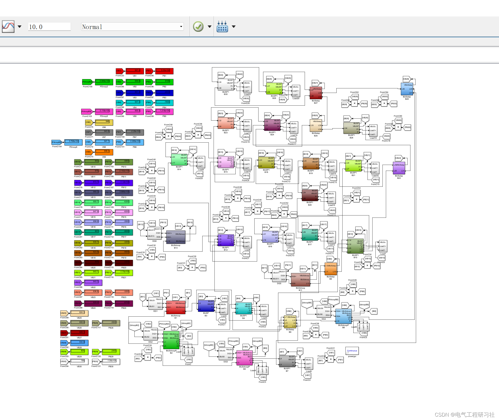
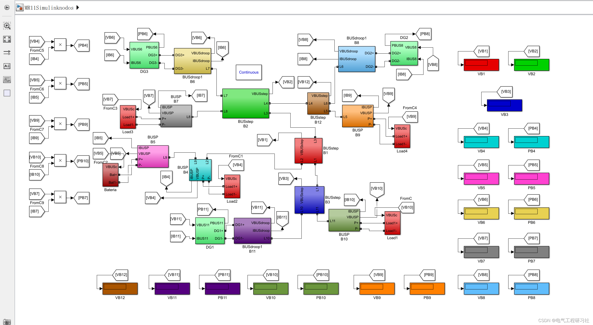
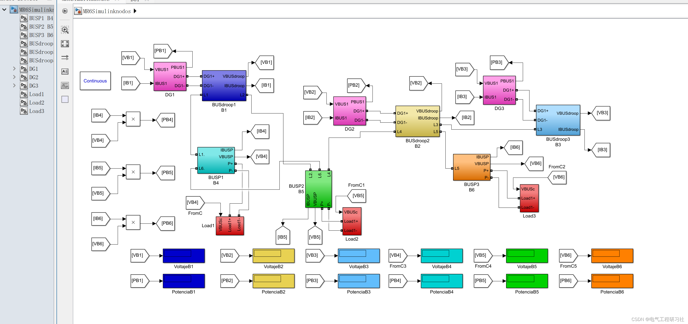
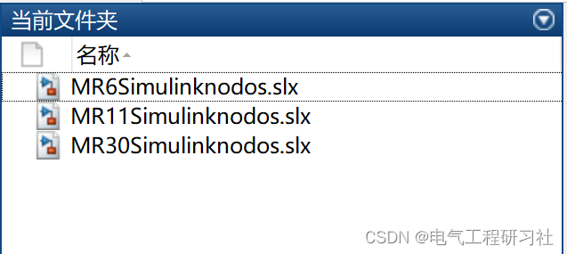
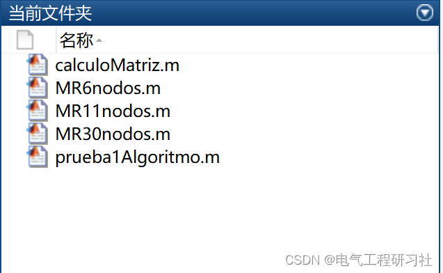

# Algorithms in Matlab combined with Simulink to solve power in DC microgrid

📋📋📋This article's table of contents is as follows: ⛳️⛳️⛳️ Table of Contents 1 Simulink Solving for DC Microgrid 2 Matlab Code Algorithm Solving for DC Microgrid 1 The Simulink solving for DC microgrid includes the following three parts:  
​Edit  
​Edit  
​Edit  
​Edit  
2 All code and Simulink simulation for the Matlab algorithm solving DC microgrid can be found in:  
​Edit
clear all\nclc\nformat shortG\n%% Verificaci algoritmo\n% Paretros base\nvref = 48;\nPbase = 500;\n\nrlineas = 0.05; \nrbase = vref^2/Pbase;\nrpu = rlineas/rbase;\n\nstep = 1;\ndroop = 2;\npotencia = 3;\n%% Datos de Lineas y Nodos\n%    Lineas   i j r\n        A = [ 4 1 rpu\n              1 2 rpu\n              2 3 rpu\n              3 4 rpu];\n%   nodo tipo     Potgen/gdroop  PotCarga   \nB = [1   droop      rbase/0.2           0\n     2   potencia    0            466.25/Pbase\n     3   droop      rbase/0.5           0\n     4   potencia    0             697.5/Pbase  ];\n\nNumN = max(max(A(:,1:2))); %Nero de Nodos\nNumL = length(A(:,1)); %Nero de Lineas\n\n%% Separaci de variables\n\nNstep = B(find(B(:,2)==step),1); %Nodos step\nVstep = B(find(B(:,2)==step),2); %Variable step\nNdroop = B(find(B(:,2)==droop),1);%Nodos droop\nVdroop = B(find(B(:,2)==droop),2); %Variable droop\nNP = B(find(B(:,2)==potencia),1);%Nodos de Pot const\nVpotencia = B(find(B(:,2)==potencia),2); %Variable Pot const\n\n%Matriz clasificaci de variables\n\nVar = [[Nstep; Ndroop; NP] [Vstep;Vdroop;Vpotencia]];\nNumVar = length(Var);\n\n%% Matriz Ybus y declaraci J y H \n%Cculo de Ybus\nY = zeros(NumN,NumN);\nfor k = 1:NumL\n    n1 = A(k,1);\n    n2 = A(k,2);\n    ykm = 1/A(k,3);\n    Y(n1,n1) = Y(n1,n1) + ykm;\n    Y(n1,n2) = Y(n1,n2) - ykm;\n    Y(n2,n1) = Y(n2,n1) - ykm;\n    Y(n2,n2) = Y(n2,n2) + ykm;\nend\n\nv = ones(NumVar,1); %Condiciones iniciales de tensi\nH=zeros(NumVar,1); %Inicializaci desajustes\nJ = zeros(NumVar,NumVar);%Declaraci matriz jacobiana\ndeltaV=zeros(NumVar,1);%Inicializaci de variaciones\n\n%% Modo Newton Raphson\ntic%contador de tiempo\n%inicio de iteraciones\nfor j=1:10\n    \n%Hacer un barrido por todas las variables    \nfor k=1:NumVar\n %Si es step, aplicar ecuaciones step \n  if Var(k,2)==step\n      pstep = 0;\n      pstepl = v(Var(k,1))*(Y(Var(k,1),:)*v);\n      H(Var(k,1)) = pstep-pstepl;\n      for i=1:NumVar\n       if Var(k,1)==i\n       J(Var(k,1),i) = -v(Var(k,1))*Y(Var(k,1),Var(k,1)) - Y(Var(k,1),:)*v;\n       else\n       J(Var(k,1),i) = -v(Var(k,1))*Y(Var(k,1),i);\n       end\n      end\n  else\n %Si es droop, aplicar ecuaciones droop\n  if Var(k,2)==droop\n      %inyecciones de potencia al nodo droop\n      pgdroop = B(Var(k,1),4);\n      %expresi incluyendo ecuas droop\n      pdroop = B(Var(k,1),3)*(1*v(Var(k,1))-v(Var(k,1))^2);\n      %potencias por las lineas\n      pdroopl = v(Var(k,1))*(Y(Var(k,1),:)*v);\n      %ecuaci de desajuste\n      H(Var(k,1)) = pdroop-pgdroop-pdroopl;\n      %Cculo de las derivadas parciales para droop k especWeiico\n      for i=1:NumVar\n        %si k=i\n        if Var(k,1)==i\n          Jdroop = B(Var(k,1),3)*(1 - 2*v(Var(k,1)));\n          Jdroopl = v(Var(k,1))*Y(Var(k,1),Var(k,1)) - Y(Var(k,1),:)*v;\n          J(Var(k,1),i) = Jdroop - Jdroopl;\n        else\n          %k != i\n          J(Var(k,1),i) = -v(Var(k,1))*Y(Var(k,1),i);\n        end\n      end\n  else\n %Si es potencia, aplicar ecuaciones potencia   \n  if Var(k,2)==potencia\n      ppot = B(Var(k,1),3)-B(Var(k,1),4); %PG-Pcarga\n      ppotl = v(Var(k,1))*(Y(Var(k,1),:)*v);%Plineas\n      H(Var(k,1)) = ppot-ppotl;%ecuaciScraping h(k) de potencia\n      for i=1:NumVar\n        %si k=i\n        if Var(k,1)==i\n      J(Var(k,1),i) = -v(Var(k,1))*Y(Var(k,1),Var(k,1)) - Y(Var(k,1),:)*v;\n        else\n        %k != i\n      J(Var(k,1),i) = -v(Var(k,1))*Y(Var(k,1),i);\n        end\n     end\n  end\n  end\n  end\n    \nend\ndeltaV=inv(J)*H;%vector de variacion\n v = v - deltaV;%Acting on variables\n I = Y*v;%calculo de corrientes nodales\n P = diag(v)*I;%potencias nodales\n %iter(j) = j;\n errAbs = abs(max(H));\nend\n%fin de iteraciones\nt=toc%fin contador de tiempo\n\n%% Muestra de Resultados\ndisp('         nodo      v(pu)         P(pu)        v(V)        P(W)')\nsolucion = [B(:,1)    v        P     vref*v  Pbase*P];\ndisp(solucion)\n\ndisp('Maximo error abs')\ndisp(errAbs)\n  
​  

## Images

<!-- PAYMENT_BLOCK -->

## Get this dataset

- Payment link (Stripe): [Buy now](https://buy.stripe.com/3cs8yP7sY87d0vu9AB)
- Payment QR code: 

<!-- /PAYMENT_BLOCK -->
